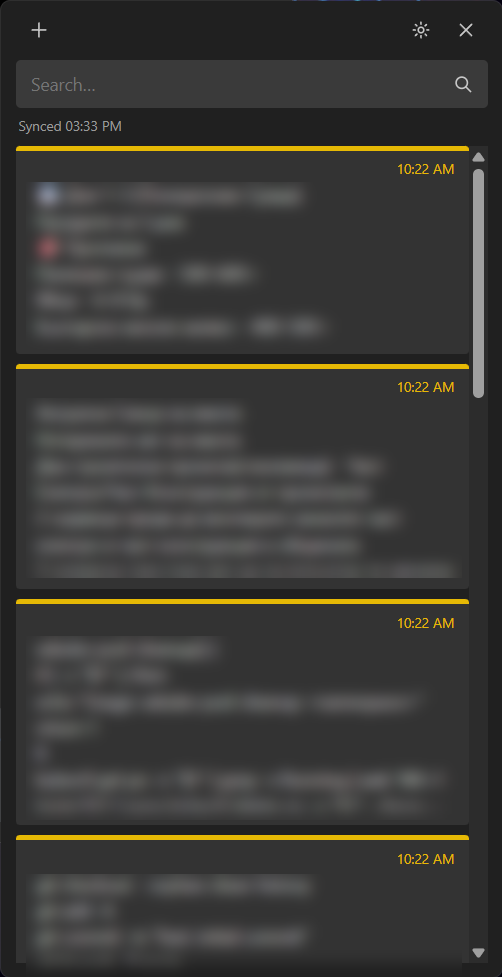
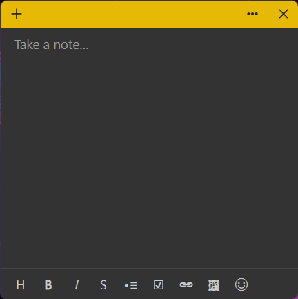

# NextStickies

Sticky notes for Windows and Linux stored as `.md` files and two-way synced
with a Nextcloud folder (default `/Notes`) over WebDAV, so the Nextcloud Notes app (web/Android/iOS) and the
desktop stickies on every machine show the same notes.

<p>
  
  
</p>

- WYSIWYG editor (Tiptap — same engine as Nextcloud Text): heading, bold, italic, strikethrough, bullets,
  checklists, links, emoji picker, paste/drop/attach images. Files stay plain markdown.
- Images are stored the Nextcloud way: `.attachments.<fileId>/name.png` next to the note.
- Note menu (⋯) with a color strip, notes list and delete; a pin button keeps a note on top of other windows.
  Unfocused notes collapse to a thin colored strip, like Windows Sticky Notes.
- Deleting asks first ("Don't ask me again" turns that off; turn it back on in Settings).
- Color, pin, position, size, open/closed are per machine (`metadata.json`), never written into notes.
- Sync: on start, 2 s after edits, every 60 s, and "Sync now". If a note changed on both sides, the newest edit
  wins. Locks left by the Nextcloud Text web editor are removed so edits from the app go through.
- Works offline; the app password is encrypted with the OS keystore (DPAPI on Windows, Secret Service on Linux).
- Tray icon; closing the list hides it to the tray (tray menu → Exit quits).

Data lives in `%APPDATA%\NextStickies` (Windows) or `~/.config/NextStickies` (Linux).

## Install
From [Releases](https://github.com/jimytar/NextStickies/releases):
- **Windows:** run `NextStickies-Setup-<version>.exe`. Per user (no admin), installs to
  `%LOCALAPPDATA%\Programs\NextStickies`, Start menu entry and Apps & features uninstaller. Upgrades close the
  running app first; notes and settings are kept on upgrade and uninstall.
- **Linux:** download `NextStickies-<version>-x86_64.AppImage`, `chmod +x` it and run it. Needs FUSE 2
  (`sudo apt install libfuse2t64`, or `libfuse2` on older releases); without it run with
  `--appimage-extract-and-run`. If it exits with a sandbox error (distros that restrict unprivileged user
  namespaces), start it with `--no-sandbox`.

Upgrading from "NC Sticky Notes" (1.x/2.0): the installer replaces the old install (keeping "Start with Windows")
and the app moves the old `NcStickyNotes` data folder on first start; notes, sticky positions, sync state and the
saved app password carry over. On Linux, re-enter the app password once after switching to the renamed AppImage.

## Setup
1. Nextcloud → Settings → Security → create an **app password**.
2. Click the gear in the notes list, enter server URL, user, app password, folder `Notes` → **Test & save**.
3. Optional: "Start with Windows" / "Start on login", "Start minimized to tray".

## Build
Everything builds in Docker (same as CI), so only Docker with buildx is needed:
```
./build.sh                  # tests, Windows app → out/app, AppImage → out/linux, installer → out/installer
./build.sh app              # tested Windows app + AppImage
./build.sh installer <dir>  # installer from a Windows app dir (CI passes the signed copy)
VERSION=1.2.3 ./build.sh    # default: next version from scripts/next-version.sh
```
Development: `cd app && npm ci && npm test && npm start` (Electron).

## Releases
`.github/workflows/release.yaml` runs on the self-hosted `next-stickies-runner`. Every push to `main` builds,
tests and publishes a GitHub release (Windows installer + AppImage) tagged `vX.Y.Z`, versioned from Conventional Commits since the last tag
(`feat` → minor, `type!:`/`BREAKING CHANGE` → major, anything else → patch). Pull requests build and upload the
packages as a workflow artifact only.

### Code signing (SignPath Foundation)
Signing steps are in the workflow but skipped until configured. After the project is approved by
[SignPath Foundation](https://signpath.org/):
1. In SignPath, create project `nextstickies` with signing policy `release-signing` and two artifact
   configurations: `app` (zip containing `NextStickies.exe` to sign) and `installer` (zip containing
   `NextStickies-Setup-*.exe`). Link the GitHub repository as the trusted build system.
2. In GitHub → Settings → Secrets and variables → Actions add secret `SIGNPATH_API_TOKEN` and variable
   `SIGNPATH_ORGANIZATION_ID`. The next run signs the app, then builds and signs the installer.
3. Check the slugs/inputs against SignPath's current docs for `signpath/github-action-submit-signing-request`.

Code signing policy: free code signing provided by [SignPath.io](https://about.signpath.io/), certificate by
[SignPath Foundation](https://signpath.org/). Releases are built and signed only by the CI workflow in this
repository from its `main` branch; maintainer and approver: [jimytar](https://github.com/jimytar). This program does
not transfer any information to other networked systems unless specifically requested by the user (the
Nextcloud server you configure).

## Layout
- `app/src/main/` — Electron main process: `store.ts` (local files + metadata), `webdav.ts`, `sync.ts`
  (3-way sync), `settings.ts`, `main.ts` (windows, tray, IPC).
- `app/src/renderer/` — notes list, sticky note (Tiptap editor), settings pages; `app/src/preload.ts` bridge.
- `app/test/` — sync tests against an in-memory WebDAV server, markdown round-trip tests.
- `installer/` — NSIS per-user installer. `Dockerfile` — build stages. `scripts/next-version.sh` — release version.

## License
MIT
